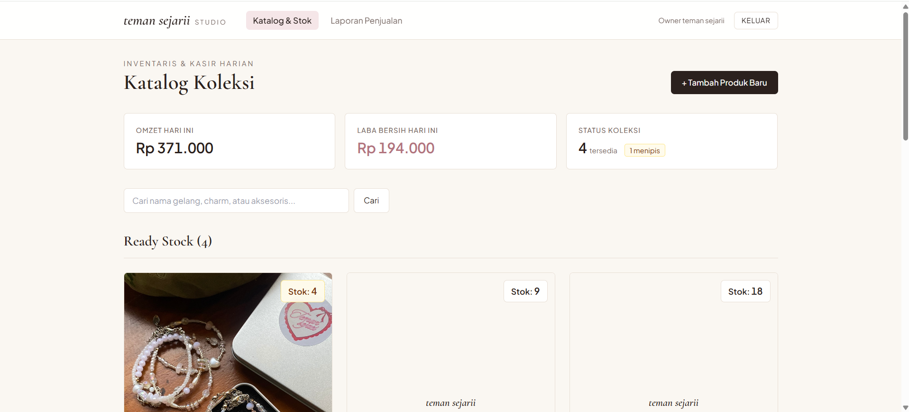
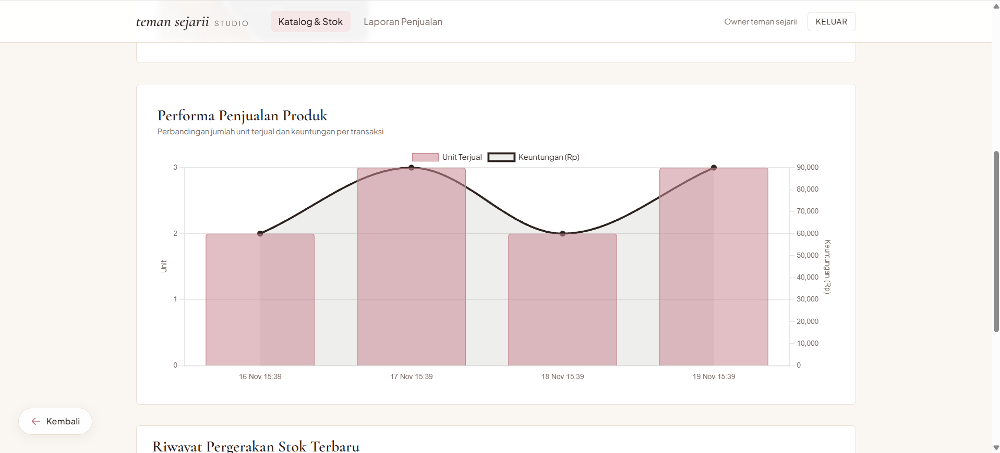
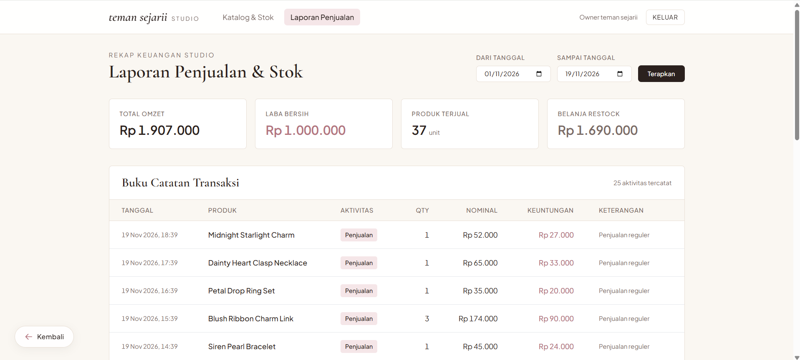
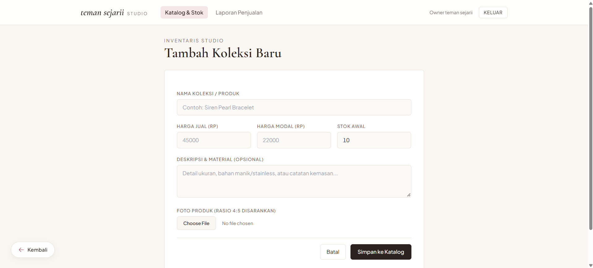
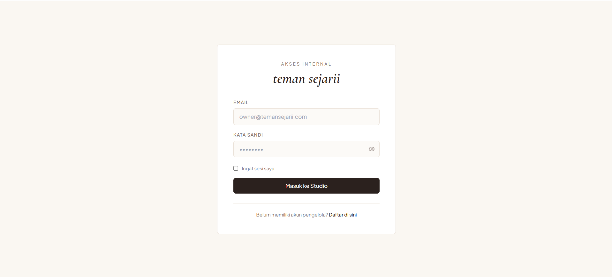
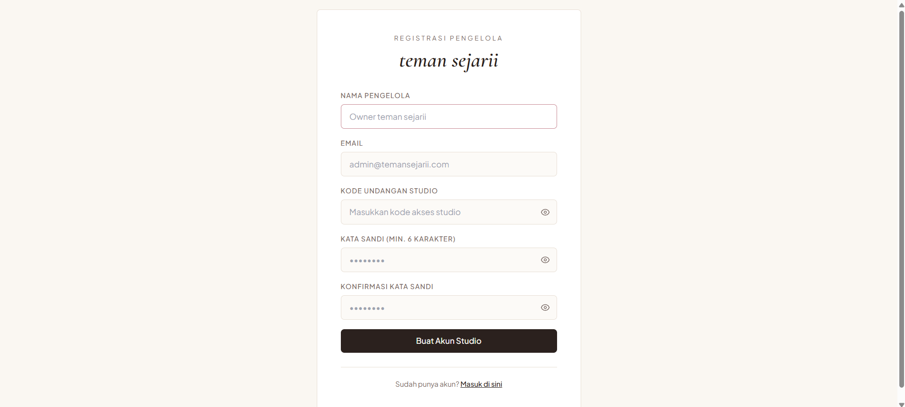

# teman sejarii — Sistem Manajemen Inventaris & Penjualan Akseseoris

**teman sejarii** adalah aplikasi web internal *full-stack* yang dirancang untuk mendukung operasional nyata bisnis ritel perhiasan dan aksesori **teman sejarii**. Sistem ini mempermudah pengelolaan inventaris, pencatatan transaksi kasir harian, pemantauan riwayat pergerakan stok, serta kalkulasi laporan laba bersih secara otomatis. Dibangun menggunakan **Laravel 11, MySQL, dan Tailwind CSS**, aplikasi ini menghadirkan desain antarmuka bergaya *editorial boutique* yang bersih, responsif, dan praktis digunakan dalam aktivitas studio sehari-hari.

---

## ✨ Fitur Utama

### 📦 Manajemen Inventaris & Katalog
- **Katalog Koleksi & Status Stok:** Menampilkan daftar seluruh produk lengkap dengan foto, harga modal (*cost price*), harga jual, serta indikator status ketersediaan otomatis (*tersedia*, *menipis*, atau *habis*).
- **Pencarian Produk Cepat:** Memudahkan pencarian koleksi gelang, charm, maupun aksesori secara instan di halaman katalog.
- **CRUD Produk Lengkap:** Menambah, memperbarui informasi/foto, dan menghapus produk dengan validasi input berlapis.

### 🧾 Kasir Harian & Pergerakan Stok
- **Pencatatan Penjualan & Restock Real-Time:** Mencatat transaksi penjualan harian maupun penambahan stok barang masuk langsung dari halaman detail produk dengan pembaruan jumlah stok otomatis.
- **Riwayat Pergerakan Stok (*Stock Logs*):** Menyimpan log seluruh aktivitas barang masuk dan keluar beserta visualisasi grafik tren stok dan penjualan per produk.
- **Ringkasan Keuangan & Laporan Penjualan:** Menyajikan metrik **Omzet Hari Ini**, **Laba Bersih Hari Ini** (dihitung otomatis dari selisih harga jual dan harga modal), serta halaman laporan penjualan terdedikasi.

### 🔐 Autentikasi & Keamanan Studio
- **Kode Undangan Studio (`STUDIO_INVITE_CODE`):** Melindungi rute registrasi pengelola baru menggunakan kode akses berbasis `.env` agar hanya pihak berwenang yang dapat membuat akun admin.
- **Kontrol Input & Interaksi UX:** Dilengkapi fitur *show/hide password* modular (`password-toggle.js`), pembatasan panjang karakter input (`maxlength`), serta tata letak navigasi yang ringkas.
- **Konfigurasi Dual-Database:** Mendukung pemisahan lingkungan database antara mode demo portofolio (`teman_sejari_demo`) dan operasional data asli (`teman_sejari`).

---

## 🧰 Tech Stack

- **Backend:** PHP 8.2+, Laravel 11
- **Database & ORM:** MySQL, Eloquent ORM
- **Templating Engine:** Laravel Blade
- **Autentikasi & Sesi:** Laravel Session Auth, Bcrypt Hashing
- **Upload File:** Laravel Public Storage (`public/images/`)
- **Frontend Styling & Scripts:** Tailwind CSS, Custom Editorial CSS, Vanilla JavaScript

---

## 📂 Struktur Proyek

```text
Teman-Sejari/
├── app/
│   ├── Http/Controllers/
│   │   ├── AuthController.php       # Login, logout & validasi STUDIO_INVITE_CODE
│   │   └── ProductController.php    # CRUD produk, mutasi stok & laporan penjualan
│   └── Models/
│       ├── Product.php              # Skema & relasi data produk
│       ├── StockLog.php             # Skema riwayat barang masuk & penjualan
│       └── User.php                 # Skema akun pengelola studio
├── database/
│   ├── migrations/                  # Skema tabel users, products & stock_logs
│   └── seeders/
│       └── DatabaseSeeder.php       # Seeder akun demo & sampel produk katalog
├── public/
│   ├── css/global.css               # Design tokens & styling editorial boutique
│   ├── images/                      # Aset foto produk
│   └── js/password-toggle.js        # Interaksi tampilkan/sembunyikan kata sandi
├── resources/views/
│   ├── auth/                        # Halaman login & registrasi pengelola
│   ├── layouts/                     # Template layout utama & autentikasi
│   ├── products/                    # Katalog, detail produk, tambah & edit
│   └── reports/                     # Halaman laporan omzet & laba bersih
├── routes/
│   └── web.php                      # Definisi rute publik & terproteksi middleware
├── .env.example                     # Template konfigurasi environment
└── composer.json
```

---

## 🚀 Cara Menjalankan Aplikasi

### 1. Prasyarat
- [PHP](https://www.php.net/) (v8.2 atau lebih baru) & [Composer](https://getcomposer.org/)
- [MySQL](https://www.mysql.com/) (via Laragon, XAMPP, atau MySQL Server)

### 2. Instalasi
Clone repositori ini dan install seluruh dependensi PHP:
```bash
git clone [https://github.com/reinmark1/Teman-Sejari.git](https://github.com/reinmark1/Teman-Sejari.git)
cd Teman-Sejari
composer install
```

### 3. Konfigurasi Environment
Salin file `.env.example` menjadi `.env`, lalu generate *application key*:
```bash
cp .env.example .env
php artisan key:generate
```

Buat database kosong bernama `teman_sejari_demo` di MySQL, lalu pastikan konfigurasi di file `.env` sudah sesuai:
```env
DB_CONNECTION=mysql
DB_HOST=127.0.0.1
DB_PORT=3306
DB_DATABASE=teman_sejari_demo
DB_USERNAME=root
DB_PASSWORD=

STUDIO_INVITE_CODE=sejarii2026
```

### 4. Migrasi Database & Jalankan Server
Jalankan migrasi beserta *seeder* data demo, lalu nyalakan server lokal:
```bash
php artisan migrate:fresh --seed
php artisan serve
```
Buka browser dan kunjungi: **`http://127.0.0.1:8000`**

---

## 🔑 Akses Demo & Registrasi Pengelola

### 1. Akun Demo (Langsung Masuk)
Setelah menjalankan `php artisan migrate:fresh --seed`, kamu dapat langsung masuk melalui halaman `/login` menggunakan akun demo berikut:

- **Email:** `owner@temansejarii.com`
- **Kata Sandi:** `rahasia123`

### 2. Alur Penambahan Admin pada Kasus Nyata (`STUDIO_INVITE_CODE`)
Karena **teman sejarii** merupakan sistem internal studio yang memuat data sensitif (harga modal, stok barang, dan laporan laba bersih), rute pendaftaran pengelola baru (`/register`) tidak dibuka untuk publik secara bebas.

Dalam skenario operasional nyata:
1. **Owner Bisnis** menetapkan kode rahasia studio pada variabel `STUDIO_INVITE_CODE` di file `.env` server produksi.
2. Saat **partner bisnis atau admin baru** perlu dibuatkan akses, Owner membagikan **Kode Undangan Studio** tersebut secara privat.
3. Calon admin membuka halaman `/register`, mengisi data diri beserta **Kode Undangan Studio**. Sistem (`AuthController`) akan memverifikasi kecocokan kode secara aman (`hash_equals`) sebelum mengizinkan pembuatan akun dan memberikan akses ke *Shared Studio Workspace*.
4. Jika suatu saat terjadi pergantian staf atau partner, Owner cukup mengganti nilai `STUDIO_INVITE_CODE` di `.env` agar kode lama tidak lagi berlaku.

Untuk menguji alur pendaftaran ini pada lingkungan demo lokal, gunakan kode akses bawaan berikut:

- **Kode Undangan Studio:** `sejarii2026`

---

## 🔄 Beralih ke Mode Operasional (Data Asli)

Untuk menggunakan aplikasi pada lingkungan bisnis nyata tanpa data dummy:
1. Buat database kosong baru bernama `teman_sejari` di MySQL.
2. Ubah variabel `DB_DATABASE=teman_sejari` di file `.env` serta ganti `STUDIO_INVITE_CODE` dengan kode rahasia pilihanmu.
3. Jalankan migrasi bersih **tanpa** *seeder*:
   ```bash
   php artisan config:clear
   php artisan migrate
   ```
4. Daftarkan akun owner utama melalui `/register` menggunakan kode undangan yang baru.

---

## 📸 Tampilan Aplikasi

| Katalog Koleksi & Ringkasan Harian | Detail Produk & Log Pergerakan Stok |
| :---: | :---: |
|  |  |

| Laporan Penjualan & Laba Bersih | Tambah Produk Koleksi |
| :---: | :---: |
|  |  |

| Masuk Studio (Login) | Registrasi Pengelola (Invite Code) |
| :---: | :---: |
|  |  |

---
